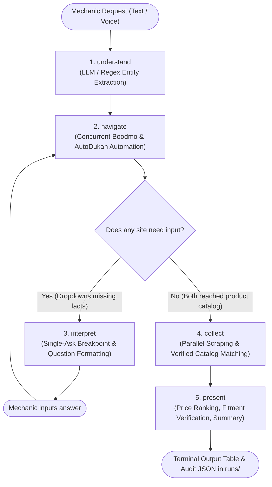
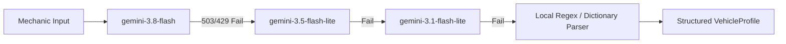
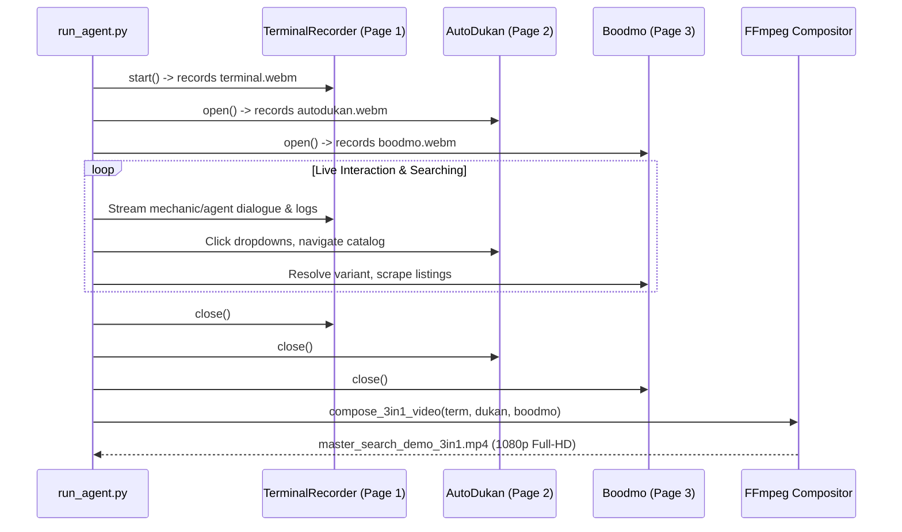

# Comprehensive Engineering Study Guide: Conversational AI Parts Sourcing Agent

A master technical study guide explaining the architecture, design patterns, LangGraph orchestration, vendor adapters (Boodmo & AutoDukan), LLM fallback pipeline, variant disambiguation mathematics, bug fixes, and multi-stream video recording systems.

---

## Table of Contents
1. [Executive Summary & Problem Domain](#1-executive-summary--problem-domain)
2. [High-Level Architecture & Lifecycle Workflow](#2-high-level-architecture--lifecycle-workflow)
3. [Component-by-Component Deep Dive](#3-component-by-component-deep-dive)
   - [3.1 CLI Entrypoint (`run_agent.py`)](#31-cli-entrypoint-run_agentpy)
   - [3.2 LangGraph State Machine (`parts_agent/graph.py`)](#32-langgraph-state-machine-parts_agentgraphpy)
   - [3.3 Core Data Models (`parts_agent/models.py`)](#33-core-data-models-parts_agentmodelspy)
   - [3.4 LLM & Heuristic Extraction Layer (`parts_agent/llm.py`)](#34-llm--heuristic-extraction-layer-parts_agentllmpy)
   - [3.5 Variant Disambiguation Engine (`parts_agent/variants.py`)](#35-variant-disambiguation-engine-parts_agentvariantspy)
   - [3.6 Boodmo Browser Adapter (`parts_agent/boodmo.py`)](#36-boodmo-browser-adapter-parts_agentboodmopy)
   - [3.7 AutoDukan Browser Adapter (`parts_agent/auto_dukan.py`)](#37-autodukan-browser-adapter-parts_agentauto_dukanpy)
   - [3.8 Voice Subsystem (`parts_agent/voice.py`)](#38-voice-subsystem-parts_agentvoicepy)
   - [3.9 Terminal Video Recorder & Compositor (`parts_agent/terminal_recorder.py`)](#39-terminal-video-recorder--compositor-parts_agentterminal_recorderpy)
4. [In-Depth Bug Analysis & Solutions](#4-in-depth-bug-analysis--solutions)
   - [Bug A: Premature Variant Selection & Duplicate Questions](#bug-a-premature-variant-selection--duplicate-questions)
   - [Bug B: Loss of Vehicle Filter & Unverified Fitment](#bug-b-loss-of-vehicle-filter--unverified-fitment)
   - [Bug C: Maker / Model Dropdown Alias Matching](#bug-c-maker--model-dropdown-alias-matching-mercedes-vs-mercedes-benz)
   - [Resiliency Enhancements: Commercial Vehicle Guard, Category Expansion & Generic Search Fallback](#resiliency-enhancements-commercial-vehicle-guard-category-expansion--generic-search-fallback)
5. [Real-Time Multi-Stream Video Recording Architecture](#5-real-time-multi-stream-video-recording-architecture)
6. [Key Design Patterns & Software Principles](#6-key-design-patterns--software-principles)
7. [Glossary & Quick Revision Q&A](#7-glossary--quick-revision-qa)

---

## 1. Executive Summary & Problem Domain

### The Challenge
In India's automotive aftermarket, mechanics source replacement parts through disjointed portals such as **Boodmo** (the largest catalog of OEM & aftermarket parts) and **AutoDukan** (a distributor marketplace).
- Mechanics communicate using colloquial, mixed-language terminology (*"Mercedes Headlight"*, *"Harrier ka oil filter chahiye, 2021 diesel automatic"*).
- Vendors maintain completely different website workflows:
  - **Boodmo**: Uses cascading static-to-dynamic select menus (*Maker ➔ Model Line ➔ Year ➔ Modification*), categorizes parts hierarchically, and obfuscates OEM part numbers behind URLs.
  - **AutoDukan**: Uses a JavaScript/React Material-UI client-rendered form on its homepage that queries private endpoints and issues an internal `car_model_id`.
- Asking mechanics separate questions for each website results in a frustrating user experience (e.g., asking for fuel type twice, or asking for engine capacity twice).

### The Solution
An autonomous agent that:
1. Interacts colloquially with the mechanic (via text terminal or hands-free voice).
2. Automates real vendor browsers concurrently using Playwright.
3. Unifies vehicle disambiguation so **the mechanic is asked each question at most once**.
4. Extracts verified in-stock parts, prices, and delivery times into a consolidated comparison table.

---

## 2. High-Level Architecture & Lifecycle Workflow

The system is structured as a cyclical LangGraph state machine:



### State Machine Lifecycle Steps
1. **`understand`**: Parses colloquial user request into an initial `VehicleProfile`.
2. **`navigate`**: Passes the profile into both adapters. Each adapter navigates dropdowns on its site. If an adapter needs more information, it returns a `NeedInput` descriptor.
3. **`interpret`**: Acts as a pause/breakpoint. Synthesizes adapter questions into a single clean prompt for the mechanic.
4. **`collect`**: Once both adapters reach their vehicle's part page, scrapes listings in parallel.
5. **`present`**: Validates fitment tags, ranks in-stock parts by lowest price, prints markdown tables, and generates a conversational summary.

---

## 3. Component-by-Component Deep Dive

### 3.1 CLI Entrypoint (`run_agent.py`)

[run_agent.py](file:///home/habilelabs/Development/CAS/backend/run_agent.py) is the executable entrypoint for the CLI application.

#### Key Functions:
- **`main()`**: Parses CLI arguments (`--show-browser`, `--record-video`, `--voice`, `--say`, `--answers`, `-v`).
- **`open_session(thread_id)`**: Initializes persistent Playwright browser contexts for the session.
- **`hear(context)`**: Collects mechanic input. If automated `--answers` are provided, it injects human-like typing delays (1.2s) so demo recordings look realistic.
- **`TerminalLogHandler`**: Forwards important `INFO` log records (`parts_agent.auto_dukan`, `parts_agent.boodmo`, `parts_agent.llm`) directly to the visual terminal recorder.
- **`print_table(outcome)`**: Formats tabular comparison output showing Match Quality, Fitment Status, Brand, Title, Part Number, Price, and Stock.

---

### 3.2 LangGraph State Machine (`parts_agent/graph.py`)

[parts_agent/graph.py](file:///home/habilelabs/Development/CAS/backend/parts_agent/graph.py) is the brain that coordinates supplier adapters and maintains session state.

#### Core Concepts:
- **`Session` Class**:
  ```python
  class Session:
      adapters: dict[str, SupplierAdapter]  # {"boodmo": BoodmoAdapter, "autodukan": AutoDukanAdapter}
      profile: VehicleProfile
      pending_need: Optional[NeedInput]
      pending_answers: dict[str, Any]
      status_cb: Optional[Callable[[str], None]]
  ```
  Keeps Playwright browser pages alive in memory between conversation turns so navigating a 4-step dropdown tree does not reset when the mechanic pauses to answer.

- **Single-Ask Synchronization (`_navigate` logic)**:
  When Boodmo is asking about complex vehicle modifications (fuel, engine size, trim, version), AutoDukan's variant question is intentionally **suppressed**:
  ```python
  # If Boodmo has an active question and AutoDukan also wants variant, suppress AutoDukan:
  if boodmo_need and dukan_need and dukan_need.field == "variant":
      active_need = boodmo_need  # Only ask Boodmo's question!
  ```
  Once Boodmo finalizes the exact variant (e.g., `3.0L E350 CDI/Diesel/OM 642.852`), it is passed into `profile.hints["boodmo_variant"]`. AutoDukan's variant matcher uses this hint to automatically select its own variant option (`3.0L E350 CDI / DIESEL`) with **zero duplicate questions**.

---

### 3.3 Core Data Models (`parts_agent/models.py`)

[parts_agent/models.py](file:///home/habilelabs/Development/CAS/backend/parts_agent/models.py) defines the schema used across the system:

- **`VehicleProfile`**:
  ```python
  @dataclass
  class VehicleProfile:
      maker: Optional[str] = None          # e.g., "MERCEDES-BENZ", "TATA"
      model: Optional[str] = None          # e.g., "E-CLASS", "HARRIER"
      year: Optional[int] = None           # e.g., 2016
      variant_filters: dict = field(default_factory=dict) # {"fuel": "Diesel", "engine_l": 3.0}
      category: Optional[str] = None       # e.g., "Headlight", "Oil Filter"
      hints: dict = field(default_factory=dict) # shared cross-adapter hints
  ```

- **`NeedInput`**:
  Represents a dropdown barrier requiring human decision:
  ```python
  @dataclass
  class NeedInput:
      field: str                           # "maker", "model", "year", "variant"
      prompt: str                          # Human-readable question
      choices: list[str]                   # Actual options scraped from the site
      adapter: str                         # "boodmo" or "autodukan"
      context: dict = field(default_factory=dict)
  ```

- **`Listing` & `Offer`**:
  Schema for extracted catalog parts:
  ```python
  @dataclass
  class Listing:
      adapter: str                         # Vendor name
      title: str                           # Product title
      part_number: str                     # OEM or aftermarket SKU
      brand: str                           # Brand name (Bosch, Hella, TVS Girling)
      fitment: str                         # "verified" or "unverified"
      match_quality: str                   # "exact", "related", "partial"
      offers: list[Offer]                  # Prices, stock counts, dispatch delays
  ```

---

### 3.4 LLM & Heuristic Extraction Layer (`parts_agent/llm.py`)

[parts_agent/llm.py](file:///home/habilelabs/Development/CAS/backend/parts_agent/llm.py) extracts vehicle attributes and translates mechanic responses into dropdown values.

#### Resilience Pipeline:


#### Deterministic Option Matching (`match_option`):
When a mechanic replies with ordinals (*"3"*, *"first one"*, *"teesra"*), colloquial names (*"Mercedes"* for `MERCEDES-BENZ`), or partial trims (*"E350"* for `3.0L E350 CDI`), `match_option()` resolves the input locally using fuzzy substring scoring and Levenshtein distance before even needing to query Gemini.

---

### 3.5 Variant Disambiguation Engine (`parts_agent/variants.py`)

[parts_agent/variants.py](file:///home/habilelabs/Development/CAS/backend/parts_agent/variants.py) provides algorithmic decision-tree pruning for vehicle variants.

#### The Problem:
A car model (like 2016 Mercedes E-Class) has dozens of variations in Boodmo's database:
- `2.1L E220 BlueTEC / DIESEL`
- `2.1L E250 CDI / DIESEL`
- `3.0L E350 CDI / DIESEL`
- `3.0L E350d / DIESEL`
- `3.5L E350 / PETROL`
- `5.5L E63 AMG / PETROL`

#### The Mathematical Decomposition:
[`parse_label()`](file:///home/habilelabs/Development/CAS/backend/parts_agent/variants.py#L30) parses each raw variant string using regular expressions into 5 orthogonal dimensions:
$$\text{Variant} = \langle \text{engine\_l}, \text{fuel}, \text{gearbox}, \text{trim}, \text{spec} \rangle$$

#### Optimal Question Sequencing (`next_question()`):
Instead of asking arbitrary questions, the engine calculates the variance across remaining options:
1. **Fuel** is checked first if both Petrol and Diesel options exist (eliminates ~50% of candidates).
2. **Transmission** is checked if Automatic and Manual exist.
3. **Engine Capacity** (e.g. 2.1L vs 3.0L) is checked next.
4. **Trim** (e.g. E250 vs E350) is checked.
5. If $\le 4$ candidates remain, it presents them as a numbered multiple-choice list:
   *"There are 4 versions. Which one is it: 1, bluetec; 2, cdi om 642.850; 3, cdi om 642.852; 4, standard?"*

---

### 3.6 Boodmo Browser Adapter (`parts_agent/boodmo.py`)

[parts_agent/boodmo.py](file:///home/habilelabs/Development/CAS/backend/parts_agent/boodmo.py) automates the Boodmo website.

#### Technical Details:
- **Category Hierarchy**: Boodmo uses URL structure `/catalog/{category_id}-{category_slug}/`. The adapter maps colloquial names (*"headlight"*, *"tail light"*, *"oil filter"*) using a cached taxonomy in [`cache/boodmo_categories.json`](file:///home/habilelabs/Development/CAS/backend/cache/boodmo_categories.json).
- **Sequential Dropdown Filling**:
  1. `Maker` (`select[name="makerId"]`)
  2. `Model Line` (`select[name="modelId"]`)
  3. `Year` (`select[name="year"]`)
  4. `Modification / Variant` (`select[name="carId"]`)
- **Concurrent Part Enrichment**:
  Once Boodmo loads the catalog page, it opens up to **4 parallel browser tabs** to fetch full product details, unmask part numbers, and extract seller dispatch guarantees.

---

### 3.7 AutoDukan Browser Adapter (`parts_agent/auto_dukan.py`)

[parts_agent/auto_dukan.py](file:///home/habilelabs/Development/CAS/backend/parts_agent/auto_dukan.py) automates AutoDukan's single-page React application.

#### Technical Details:
- **MUI Custom Selects**: AutoDukan does not use standard HTML `<select>` tags. It renders Material-UI dropdowns (`div.MuiSelect-select`). The adapter clicks the element, waits for the floating `div.MuiPopover-root` popover to render in the DOM, and clicks the matching `li.MuiMenuItem-root`.
- **Form Submission & ID Extraction**: Clicking `Find Parts` navigates to:
  `https://autodukan.com/products-list?car_model_id=24103`
  The adapter captures this `car_model_id` parameter directly from the current URL.
- **Category Navigation**: Navigates to `/products-list/{slug}?car_model_id={id}` so the vehicle filter is preserved.

---

### 3.8 Voice Subsystem (`parts_agent/voice.py`)

[parts_agent/voice.py](file:///home/habilelabs/Development/CAS/backend/parts_agent/voice.py) provides hands-free speech input and output.
- **Speech-to-Text (STT)**: Records audio from the microphone via `arecord`, monitors RMS amplitude for speech silence detection, and transcribes the WAV audio using Gemini audio models.
- **Text-to-Speech (TTS)**: Synthesizes voice audio via Gemini TTS models, with local fallback to `spd-say`.

---

### 3.9 Terminal Video Recorder & Compositor (`parts_agent/terminal_recorder.py`)

[parts_agent/terminal_recorder.py](file:///home/habilelabs/Development/CAS/backend/parts_agent/terminal_recorder.py) is a custom engine built to record the CLI conversation side-by-side with browser automation.

#### How It Works:
1. Playwright starts a headless Chromium page loaded with a styled dark-mode terminal HTML template (`TERMINAL_HTML`).
2. When the agent speaks, mechanic answers, or background searches log events, lines are streamed into this page via `evaluate("append(...)")`.
3. Playwright records the page directly as video via `record_video_dir`.
4. At run completion, **FFmpeg** composites the video streams into a unified 1920×1080 Full-HD MP4.

```
+------------------------------------+------------------------------------+
|                                    |    AutoDukan Automation (960x540)  |
|                                    |                                    |
|       Terminal CLI (960x1080)      +------------------------------------+
|   Mechanic Dialogue + Search Logs  |      Boodmo Automation (960x540)   |
|                                    |                                    |
+------------------------------------+------------------------------------+
```

---

## 4. In-Depth Bug Analysis & Solutions

### Bug A: Premature Variant Selection & Duplicate Questions

#### Symptom:
When the mechanic answered *"Diesel"*, AutoDukan immediately printed:
`AutoDukan selected its variant option '3.0L E350 CDI / DIESEL' using base matching variant for stated details`
even though Boodmo was still trying to determine whether the car was a 2.1L or a 3.0L engine. Furthermore, if both adapters were unconstrained, the mechanic was asked separate variant questions by both websites.

#### Cause:
In `parts_agent/auto_dukan.py`, inside `_resolve_vehicle_field("variant")`, the code contained an aggressive fallback:
```python
# PREVIOUS BUGGY CODE:
base_cands = [c for c in constrained if not any(t in c.upper() for t in special_tags)]
best = base_cands[0] if base_cands else constrained[0]
matches = [best]  # Arbitrarily picked the first option!
```

#### Fix:
1. **Removed the guessing fallback**: In `parts_agent/auto_dukan.py`, if multiple variants match the mechanic's current input and `boodmo_variant` is not yet available, `matches` remains empty, forcing AutoDukan to register a `NeedInput(field="variant")`.
2. **LangGraph Variant Coordination**: In `parts_agent/graph.py`, while Boodmo is navigating its variant tree, AutoDukan's variant question is suppressed.
3. **Cross-Adapter Propagator**: When Boodmo and the mechanic resolve the exact modification (e.g., `MERCEDES-BENZ E-CLASS 2016 3.0L E350 CDI/Diesel/OM 642.852`), it is injected into `profile.hints["boodmo_variant"]`. AutoDukan's [`_score_best_variant()`](file:///home/habilelabs/Development/CAS/backend/parts_agent/auto_dukan.py#L115) compares word overlap and selects `3.0L E350 CDI / DIESEL` automatically.

---

### Bug B: Loss of Vehicle Filter & Unverified Fitment

#### Symptom:
Boodmo returned exact-fitting parts (`fit: verified`), but AutoDukan returned `fit: unverified` and displayed unrelated items (e.g. BMW headlights for a Mercedes).

#### Cause:
1. **URL Redirect Reset**: On AutoDukan, after selecting the vehicle and clicking `Find Parts`, the browser reached `https://autodukan.com/products-list?car_model_id=24103`. However, [`_select_category()`](file:///home/habilelabs/Development/CAS/backend/parts_agent/auto_dukan.py) called `await self._goto(f"{self.base_url}/category")` and navigated to `/products/lighting/headlight?page=1` **without** `car_model_id`. This wiped out the vehicle selection and searched site-wide across 6,600 headlights.
2. **Hardcoded Fitment**: AutoDukan listings were hardcoded to `fitment="unverified"`.

#### Fix:
1. **Preserve `self._car_model_id`**: Added state variable `self._car_model_id` captured from the post-submission URL.
2. **Targeted Routing**: Added [`_slug_for_category()`](file:///home/habilelabs/Development/CAS/backend/parts_agent/auto_dukan.py#L140) to route directly to:
   ```
   https://autodukan.com/products-list/{slug}?car_model_id={self._car_model_id}
   ```
3. **Verified Fitment**: Listings from this vehicle-specific URL are tagged `fitment="verified"`.
4. **Out-of-Stock Notification**: When AutoDukan shows *"Product not found"* for a verified vehicle search, the agent correctly reports: `AutoDukan has no HEADLIGHT in stock for MERCEDES-BENZ E-CLASS 2016 3.0L E350 CDI / DIESEL.` with `status="ok"` and `listings=[]`, rather than showing unrelated products.

---

### Bug C: Maker / Model Dropdown Alias Matching ("Mercedes" vs "MERCEDES-BENZ")

#### Symptom:
Sourcing for `"Mercedes E-class brake pads"` resulted in:
```text
RuntimeError: Option 'Mercedes' not found in maker dropdown
```
AutoDukan mapped `"Mercedes"` to `"MERCEDES-BENZ"` correctly, but Boodmo crashed during maker selection.

#### Cause:
1. In `parts_agent/graph.py`, `understand()` previously set `profile.maker = parsed.make` (which was `"Mercedes"`).
2. In `parts_agent/boodmo.py`, the dropdown logic was:
   ```python
   if not profile.maker:
       chosen = await self._match_or_ask("maker", profile.hints.get("make"), makers, ...)
   await self._choose("maker", profile.maker)
   ```
   Since `profile.maker` was already populated with `"Mercedes"`, it bypassed `_match_or_ask` and attempted to select `"Mercedes"` directly from `<select name="makerId">`. However, Boodmo's canonical dropdown label is `"MERCEDES-BENZ"`, raising an exception.

#### Fix:
1. **Robust Dropdown Membership Validation**: In `parts_agent/boodmo.py`, changed the check to:
   ```python
   if not profile.maker or profile.maker not in makers:
       chosen = await self._match_or_ask(
           "maker", profile.maker or profile.hints.get("make"), makers, "maker"
       )
   ```
   The same check was applied to `profile.model not in models`.
2. **Preserve Raw Hints in Graph**: In `parts_agent/graph.py`, kept the raw extracted string in `profile.hints["make"]` and allowed each supplier's adapter to independently map vendor-specific aliases (`"Mercedes"` ➔ `"MERCEDES-BENZ"`, `"VW"` ➔ `"VOLKSWAGEN"`).

---

### Resiliency Enhancements: Commercial Vehicle Guard, Category Expansion & Generic Search Fallback

1. **Commercial Vehicle Guard ([`parts_agent/llm.py`](file:///home/habilelabs/Development/CAS/backend/parts_agent/llm.py))**:
   - Small Commercial Vehicles (SCVs) and Light Commercial Vehicles (LCVs) like Tata Ace, Ashok Leyland Dost, and Bolero Maxi Truck are excluded from passenger car dropdown trees.
   - `check_commercial_vehicle()` proactively detects them and announces:
     *"Tata Ace is a commercial vehicle. AutoDukan and Boodmo only list passenger cars and SUVs."*
2. **Category Taxonomy Expansion ([`cache/boodmo_categories.json`](file:///home/habilelabs/Development/CAS/backend/cache/boodmo_categories.json))**:
   - Expanded leaf and part mappings for high-frequency replacement parts: `spark_plug`, `wiper_blade`, `battery`, `clutch_set`, `radiator`, `horn`.
   - AutoDukan's `_slug_for_category()` was synchronized to handle all of these categories without 404s.
3. **Generic Search Fallback**:
   - When a requested vehicle model or category does not exist in the dropdown selectors (or when a commercial vehicle is queried), both adapters automatically fall back to the site's top search bar:
     - Boodmo: `https://boodmo.com/search/{query}/`
     - AutoDukan: `https://autodukan.com/products-list?search={query}`
   - Results from fallback keyword searches are cleanly marked `fitment="unverified"` so mechanics are informed of the match method.
4. **Major Assembly Disambiguation Guard ([`parts_agent/llm.py`](file:///home/habilelabs/Development/CAS/parts_agent/llm.py), [`parts_agent/graph.py`](file:///home/habilelabs/Development/CAS/parts_agent/graph.py))**:
   - Retail automotive catalogs (Boodmo, AutoDukan) do NOT sell complete drop-in gearbox assemblies or crate engines online; they stock individual replacement components and repair kits.
   - When a mechanic queries `"gear box"`, the system prevents low-confidence fuzzy falls into minor accessories (such as a ₹124 rubber dust boot / `"Gear Lever Bellow"`).
   - Proactively catches broad assembly queries via `check_major_assembly()`, explains the supplier inventory constraint, and presents high-frequency replacement components (*Gearbox Mounting*, *Gear Shift Cable*, *Clutch Kit*, *Gear Shifter Repair Kit*, *Transmission Fluid*).
   - Automatically sanitized `cache/boodmo_categories.json` to prevent polluted cross-category cache poisoning.
5. **Procurement Separation & Recommendation Engine ([`frontend/src/components/ProductResults.jsx`](file:///home/habilelabs/Development/CAS/frontend/src/components/ProductResults.jsx))**:
   - Replaced mixed cross-supplier rows with dedicated, isolated sections for each adapter:
     - **Boodmo Catalog Section**: Dedicated table for Boodmo verified parts, dispatch speeds, and stock.
     - **AutoDukan Catalog Section**: Dedicated table for AutoDukan verified parts, dispatch speeds, and stock.
   - **Executive Recommendation Bar**: Evaluates best in-stock prices and lead times, generating a one-click copyable verdict for procurement to read directly to the mechanic.
   - **Side-by-Side & Stacked Views**: Allows side-by-side (50/50 split) or dedicated stacked view modes.

---

## 5. Real-Time Multi-Stream Video Recording Architecture

The agent features native multi-stream video composition for generating customer and engineering demos:



### FFmpeg Filtergraph Pipeline:
```bash
ffmpeg -i terminal.webm -i autodukan.webm -i boodmo.webm -filter_complex \
  "[0:v]scale=960:1080:force_original_aspect_ratio=decrease,pad=960:1080:(ow-iw)/2:(oh-ih)/2:color=#0b0f19[term]; \
   [1:v]scale=960:540:force_original_aspect_ratio=decrease,pad=960:540:(ow-iw)/2:(oh-ih)/2:color=#111827[dukan]; \
   [2:v]scale=960:540:force_original_aspect_ratio=decrease,pad=960:540:(ow-iw)/2:(oh-ih)/2:color=#111827[boodmo]; \
   [dukan][boodmo]vstack[right]; \
   [term][right]hstack[out]" \
  -map "[out]" -c:v libx264 -crf 22 -pix_fmt yuv420p output.mp4
```

---

## 6. Key Design Patterns & Software Principles

1. **State Machine Pattern (LangGraph)**:
   - Manages asynchronous, non-linear multi-turn conversations cleanly without nested callback hell.
2. **Adapter Pattern (`SupplierAdapter`)**:
   - Both `BoodmoAdapter` and `AutoDukanAdapter` inherit from the same interface (`navigate(profile)`, `collect(profile)`), allowing additional suppliers (e.g. PartsBigBoss, MotorOctane) to be added without modifying the core graph.
3. **Strategy Pattern (Disambiguation)**:
   - Variant pruning selects the optimal question dynamically based on candidate variance rather than a hardcoded decision tree.
4. **Graceful Degradation (Fallback Chain)**:
   - LLM errors automatically degrade from large models to light models to local regex, guaranteeing the agent never crashes during network outages.

---

## 7. Glossary & Quick Revision Q&A

### Q1: Why does AutoDukan use `car_model_id` instead of query strings?
**A**: AutoDukan's catalog API requires an internal numeric database identifier (e.g. `24103` for Mercedes E-Class 2016 3.0L E350 CDI). Submitting the homepage React form generates this identifier, which must be retained in `/products-list/{category}?car_model_id={id}` to prevent the site from showing generic, non-fitting parts.

### Q2: How is the mechanic prevented from answering the same question twice?
**A**: The LangGraph state machine shares a single `VehicleProfile` across both vendor adapters. When Boodmo leads variant disambiguation, AutoDukan's variant question is suppressed. The resolved variant is then automatically passed into AutoDukan's scorer to select its matching option silently.

### Q3: What is the purpose of the 4 concurrent browser tabs in Boodmo?
**A**: Boodmo's main catalog page masks part numbers and hides full seller offers. Spawning 4 parallel tabs enriches up to 12 parts concurrently, cutting scrape time from ~40 seconds down to ~8 seconds.

---

*Study guide generated for the Conversational AI Sourcing Agent repository.*
