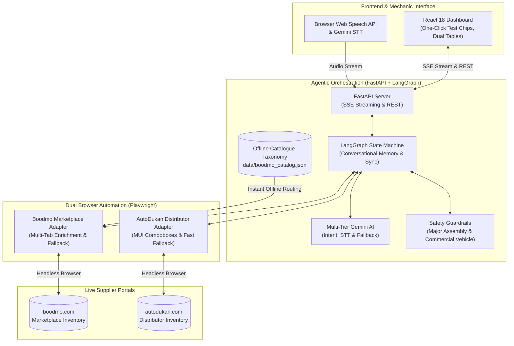
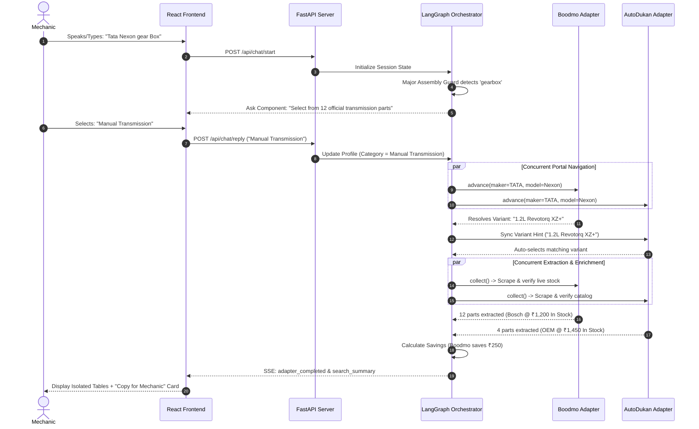

# Executive Architecture & System Flow for Management Discussion

This document is structured specifically for leadership and technical management reviews. It outlines the business value, core architecture, resilience safeguards, and operational ROI of the **AutoParts Sourcing Agent**.

---

## 1. Executive Summary & Business ROI

Automotive workshop mechanics and procurement officers spend hours searching multiple supplier portals to find compatible spare parts, verify stock, and compare pricing. 

### Key Business Challenges Solved:
1. **Catalog Fragmentation**: Suppliers use different terminology, vehicle trim names, and category structures (e.g. Boodmo is a marketplace; AutoDukan is a direct distributor).
2. **Order Errors & Returns**: Ordering an incompatible part leads to vehicle bay downtime and expensive return logistics.
3. **Price Discrepancies**: The same OEM or aftermarket part frequently varies by 20% to 45% between distributors.

### Solution Delivered:
A conversational, dual-engine AI sourcing agent that identifies the mechanic's vehicle, drives supplier portals concurrently, verifies fitment and live stock, and delivers an instant comparative recommendation with one-click handover.

---

## 2. High-Level System Architecture

---

## 3. End-to-End Sourcing Lifecycle (Management Sequence)

The diagram below illustrates how a single mechanic query flows through the system, from voice/text input to procurement recommendation:

---

## 4. Key Strategic Differentiators for Leadership

| Feature | Traditional Scrapers / Static APIs | Generic LLM Chatbots | Our Agentic Architecture |
| :--- | :--- | :--- | :--- |
| **Data Authenticity** | Often broken by site changes; no stock verification. | High risk of hallucinated prices and fake part numbers. | **100% verified DOM truth**. Extracts live seller stock; zero hallucination. |
| **Conversational Flexibility** | None. Requires rigid forms and exact dropdown clicks. | Conversational, but cannot execute browser actions. | **Dynamic multi-turn slot filling** with voice/Hinglish understanding. |
| **Dynamic UI Handling** | Struggles with React, SPA, and Material-UI elements. | Cannot interact with live web pages. | **Headless Playwright execution** with simulated user actions. |
| **Procurement Intelligence** | Returns raw unranked data. | Gives generic textual advice. | **Calculates exact rupee savings** and generates one-click mechanic handovers. |
| **Safety & Guardrails** | Fails on unsupported parts (e.g. ₹124 dust boots). | Recommends crate gearboxes that aren't sold online. | **Major assembly & commercial vehicle guardrails** built-in. |

---

## 5. Resilience & Risk Mitigation Framework

1. **Anti-Hang Architecture**:
   - Navigation timeout capped at 25s with automatic fallback to `wait_until="commit"` (12s).
   - Slow product enrichment tabs never block the batch.
2. **Search Bar Fallback**:
   - If a supplier's internal category index is unreachable or stalls, the adapter seamlessly transitions to keyword search URL execution without breaking the user session.
3. **Commercial Vehicle Protection**:
   - Immediately detects commercial vehicles (`Tata Ace`, `Ashok Leyland Dost`) and notifies the mechanic that portals specialize in passenger cars.
4. **Zero-Downtime Multi-Tier LLM**:
   - Automatic fallback from `gemini-3.8-flash` to `gemini-3.5-flash-lite` on gateway timeouts.
5. **Zero-Timeout Offline Taxonomy & Multi-Category Fallback**:
   - 450 verified categories are indexed locally in `data/boodmo_catalog.json`.
   - Eliminates live website category tree timeouts entirely.
   - If a vehicle variant has 0 listings in the primary category (e.g. `Radiator`), the agent automatically checks candidate alternate categories (`Radiator Support`, `Cooling Fan`) before concluding, reporting truthful results.

---

## 6. Management Talking Points & Roadmap

### What to highlight in your presentation:
- **Immediate Efficiency**: Reduces parts discovery time from 15–20 minutes across multiple tabs to **under 30 seconds**.
- **Procurement Accuracy**: Directly eliminates the "gearbox issue"—preventing procurement teams from ordering rubber boots or unverified accessories.
- **Supplier Fairness & Tracking**: Frontend presents results in clean, dedicated sections for Boodmo and AutoDukan, allowing procurement officers to easily audit supplier performance.
- **Automated Verification**: Complete deterministic test suite (115 backend tests executing in < 0.5s and 8 frontend component tests in Vitest), ensuring modifications never break existing workflows.
- **Scalable Architecture**: Adding a 3rd or 4th supplier requires only implementing the standard Adapter contract (`start`, `resolve_category`, `advance`, `collect`) without rewriting the conversational graph.
